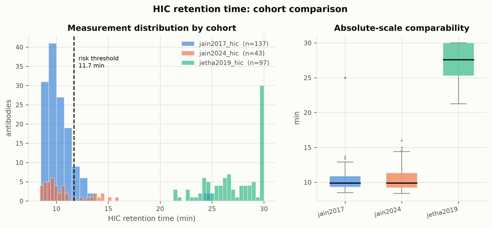
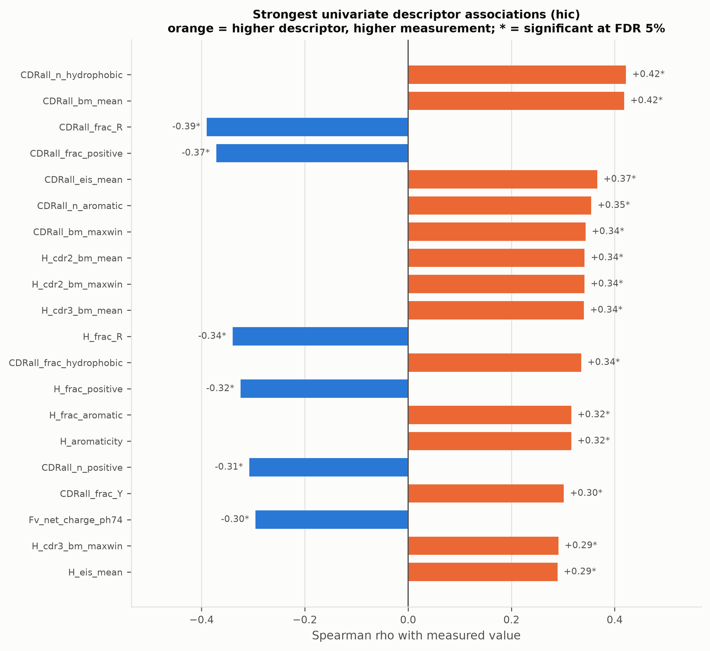
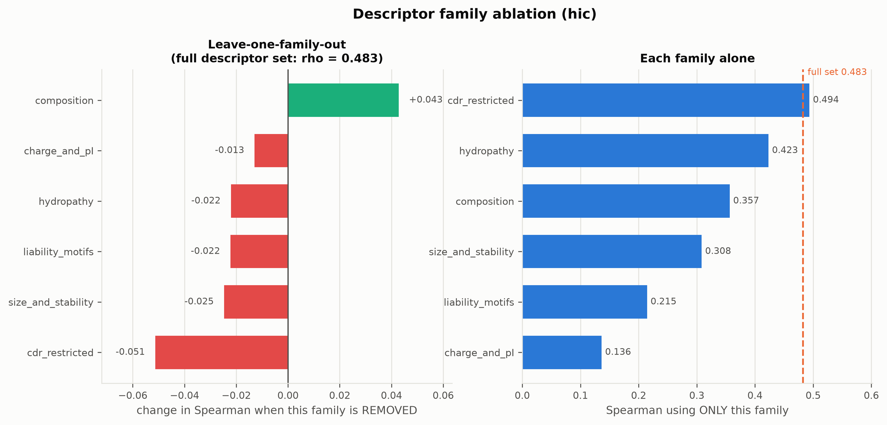
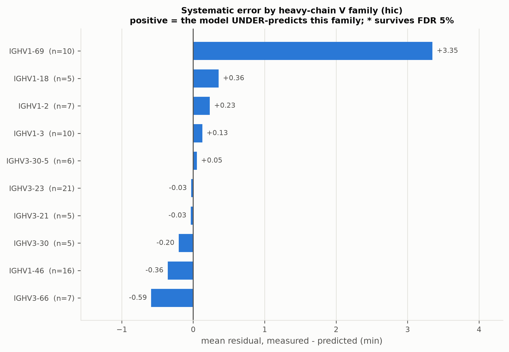

# Predicting Antibody Developability from Sequence

**A reproducible, sequence-only model for HIC retention time — validated on antibodies it has never seen.**

<p align="left">
  
  
  
  
  
</p>

Antibodies fail in development for reasons unrelated to binding: they aggregate, self-associate,
or behave badly on a column. This project predicts **one precisely defined** developability
endpoint from heavy + light chain sequence alone, and tests it on a cohort held out entirely.

---

## Quick start

```bash
git clone https://github.com/<your-username>/antibody-developability.git
cd antibody-developability
```

**1. Build the environment** (creates `.venv`, installs pinned deps, runs a smoke test):

```bash
powershell -ExecutionPolicy Bypass -File .\scripts\00_setup_env.ps1
```

**2. Run the whole study** — data → features → models → figures → report:

```bash
powershell -ExecutionPolicy Bypass -File .\scripts\run_all.ps1
```

**3. Screen your own candidates** against the trained model:

```bash
.\.venv\Scripts\python.exe -m src.tool.screen --input my_candidates.csv --endpoint hic --output screened.csv --report screened.md
```

Input needs `heavy_chain` and `light_chain` columns. You get back a predicted retention time,
a calibrated prediction interval, a risk call, an applicability-domain flag, and a chemical
liability report.

<details>
<summary><b>Other useful commands</b></summary>

```bash
# fast smoke test (small model zoo, 2 CV repeats)
powershell -ExecutionPolicy Bypass -File .\scripts\run_all.ps1 -Quick -Repeats 2
```
```bash
# verify the install (14 checks, ~30s)
.\.venv\Scripts\python.exe -m tests.smoke
```
```bash
# worked demo: screen the held-out cohort, where the true answers are known
.\.venv\Scripts\python.exe scripts\demo_screen.py
```

Runtime: ~2–3 hours on a 12-core laptop, CPU only. The first run downloads ~320 MB of model
weights. `PYTHONIOENCODING=utf-8` is required on Windows — several assay column names contain
`∆`, `λ` and `°`.
</details>

---

## Results

| | Spearman ρ | MAE |
|---|---|---|
| **Cross-validated** (5×5 CDR-clustered nested CV) | **0.536 ± 0.054** | 0.93 min |
| **Held-out cohort** (Jain 2024, n=43, zero overlap) | **0.492** `[0.20, 0.73]` | 1.41 min |

Full-refit permutation test: **p = 0.0099**. External ROC-AUC **0.741** at the published
11.7-min risk threshold.

**Representations compared**, identical protocol, best model per row:

| features | dims | ρ | |
|---|---|---|---|
| Physicochemical descriptors | 388 | **0.536** | ████████ |
| └ CDR-restricted only | 260 | 0.501 | ███████ |
| └ whole-chain only | 128 | 0.477 | ███████ |
| Descriptors + AbLang2 | 868 | 0.468 | ██████ |
| ESM-2 35M — general protein LM | 960 | 0.387 | █████ |
| AbLang2 — antibody-specific LM | 480 | 0.323 | ████ |
| *Trivial floor* (lengths + hydropathy) | 4 | *0.257* | ███ |

Interpretable descriptors beat both language models here. The ESM-2 vs AbLang2 gap is **not**
statistically distinguishable at n=137 — the paired bootstrap CI spans zero, and the report
says so rather than narrating a ranking.

**Across four endpoints, four different representations win** — an argument against treating
"developability" as one quantity:

| endpoint | best features | CV ρ | external ρ |
|---|---|---|---|
| HIC retention time | descriptors | 0.536 | 0.492 |
| Fab melting temp. (DSF) | descriptors + AbLang2 | 0.508 | 0.437 |
| AC-SINS self-interaction | AbLang2 | 0.426 | 0.272 |
| Poly-specificity (PSR) | descriptors | 0.388 | 0.304 |

---

## Key concepts

### 1. One assay, not "developability"

FLAb bundles assays measuring different physics in incompatible units. On the *same* 137
antibodies most endpoint pairs correlate weakly, so a model trained on their union would
mostly learn which assay a row came from.

**HIC retention time** was chosen because it is a single unambiguous readout, mechanistically
tied to surface hydrophobicity, and the only endpoint available in three independent cohorts.



Two cohorts (blue, orange) share a scale and a median — that is real external validation. The
third (green) sits at a different scale entirely with a censoring spike at the 30-min column
ceiling: it is a **point-mutant library of a single antibody**, so it is reported as a labelled
out-of-distribution stress test, never as validation. Applying the published risk threshold to
it flags 97 of 97 antibodies.

### 2. The model recovers the biophysics unprompted



CDR hydrophobicity and aromatic content push retention **up**; arginine and positive charge pull
it **down** — exactly the mechanism described in the literature, learned from data. Three
hydrophobicity scales were computed rather than one: Black–Mould outranks Eisenberg, and
Kyte–Doolittle doesn't appear at all, matching reports that KD is a poor choice for HIC
specifically. Including all three turned a hidden assumption into a measured result.

### 3. Leakage control: cluster on CDRs, not whole sequences

Every antibody shares 70–85% framework identity with every other, so whole-chain identity cannot
tell near-duplicates apart. We cluster on **CDR identity** and split by cluster. The panel turns
out to be largely non-redundant — but one pair has *identical CDRs* on two different germline
frameworks (measured 8.9 vs 8.8 min). Put one in train and the other in test and the model
"predicts" it by recall.

Measured optimism from random splitting: **+0.020 (SE 0.026)** — indistinguishable from zero on
*this* panel. The report states that plainly instead of implying the protocol rescued it.

### 4. Which features actually carry the signal



CDR-restricted descriptors **alone** (260 features) match the full 388-feature set, and dropping
composition features slightly *helps*. This is the Therapeutic Antibody Profiler premise — that
CDR hydrophobicity is what matters — confirmed by ablation rather than assumed.

### 5. The model has a known blind spot



**IGHV1-69** antibodies elute 3.8 min later than average (survives FDR correction), and the model
under-predicts them by 3.35 min. That germline carries an unusually hydrophobic CDR-H2 apex, so
it is exactly what a hydrophobicity assay should retain longest. The bias is *nominally*
significant but does **not** survive correction across 10 families — so it is labelled a
hypothesis, with the practical advice to treat IGHV1-69 predictions as a floor.

### 6. Honest uncertainty

Split-conformal prediction intervals carry a finite-sample coverage guarantee **under
exchangeability** — which a new cohort breaks by definition. So coverage is *measured*, not
claimed: **0.56 against a nominal 0.80** on the external set. Reported, not buried.

Other negative results kept in: zero chemical liability motifs survive FDR (79 tested), and the
AC-SINS external confidence interval includes zero.

---

## Project tree

```
├── scripts/
│   ├── 00_setup_env.ps1        venv + pinned dependency install
│   ├── run_all.ps1             full pipeline (pre-flight → … → tool demo)
│   └── demo_screen.py          worked demo on the held-out cohort
│
├── src/
│   ├── config.py               endpoints, thresholds, split protocol, seeds
│   ├── data/
│   │   ├── acquire.py          pinned sparse clone of FLAb + SHA-256 manifest
│   │   ├── curate.py           cleaning, dedup, risk labels, leakage removal
│   │   └── splits.py           CDR clustering, grouped folds, applicability domain
│   ├── features/
│   │   ├── numbering.py        AntPack IMGT numbering, CDRs, germlines, liabilities
│   │   ├── descriptors.py      physicochemical + CDR + TAP-style features
│   │   ├── plm.py              AbLang2 and ESM-2 embeddings (disk-cached)
│   │   └── build.py            feature-set assembly
│   ├── models/
│   │   ├── zoo.py              7 estimators + hyper-parameter grids
│   │   ├── train.py            nested CV, external eval, permutation tests
│   │   ├── metrics.py          metrics, bootstrap CIs, conformal intervals
│   │   └── experiment.py       the sweep and all result artefacts
│   ├── analysis/
│   │   ├── eda.py              provenance and distribution figures
│   │   ├── motifs.py           liability / composition / positional / attribution
│   │   ├── error_analysis.py   residuals, germline bias, applicability, ablation
│   │   └── plotting.py         shared colourblind-safe figure style
│   ├── tool/screen.py          the command-line screening tool
│   └── report/build_report.py  generates the report from result artefacts
│
├── tests/smoke.py              14 pre-flight checks, run before any compute
│
├── data/processed/             curated datasets, splits, provenance manifest
├── results/                    tables (CSV), figures (PNG), predictions, summaries
├── models_store/               trained models (joblib)
│
├── report/FINAL_REPORT.md      ← the result, every number read from artefacts
└── docs/
    ├── METHODOLOGY.md          why it is built this way, incl. what changed
    ├── LITERATURE_REVIEW.md    ~30 references with DOIs
    └── DELIVERABLES.md         requirement → artefact map
```

---

## Reproducibility

- **Data pinned** to a FLAb commit hash, with SHA-256 of every consumed file
- **Environment pinned** in `requirements-lock.txt` (76 packages)
- **Single seed** drives splits, model init, bootstrap and permutations
- **Report generated** from artefacts — no number in it is typed by hand
- **Pre-flight suite** runs before any compute, including a static undefined-name check

> **On ANARCI:** the field-standard numbering tool shells out to HMMER and cannot be
> pip-installed on Windows. This project uses **AntPack 0.3.8.6.2** instead (one dependency,
> cp313 wheel, no licence key), verified against published trastuzumab CDRs before use.

## Limitations

A **triage and ranking aid, not a safety assessment.** n=137 is small — the bootstrap CI on the
headline ρ spans [0.30, 0.57]. Sequence-only features cannot distinguish buried from exposed
hydrophobic residues, which is exactly what HIC responds to; this is the main reason
structure-based models outperform. Absolute predictions are meaningful only on the same HIC
platform. Antibodies flagged `extrapolation` should be read as *unknown*, not safe. Full
discussion in [`report/FINAL_REPORT.md`](report/FINAL_REPORT.md) §8–9.

---

## References

**Data**

1. Jain T, *et al.* (2017). Biophysical properties of the clinical-stage antibody landscape. *PNAS* **114**(5):944–949. [doi:10.1073/pnas.1616408114](https://doi.org/10.1073/pnas.1616408114)
2. Jain T, *et al.* (2024). Assessment and incorporation of in vitro correlates to pharmacokinetic outcomes in antibody developability workflows. *mAbs* **16**(1):2384104. [doi:10.1080/19420862.2024.2384104](https://doi.org/10.1080/19420862.2024.2384104)
3. Jetha A, *et al.* (2018). Homology modeling and structure-based design improve HIC behavior of integrin binding antibodies. *mAbs* **10**(6):890–900. [doi:10.1080/19420862.2018.1475871](https://doi.org/10.1080/19420862.2018.1475871)
4. Chungyoun M, Ruffolo JA, Gray JJ (2024). FLAb: Benchmarking deep learning methods for antibody fitness prediction. *bioRxiv* 2024.01.13.575504 · [github.com/Graylab/FLAb](https://github.com/Graylab/FLAb)

**Models & tools**

5. Olsen TH, Moal IH, Deane CM (2024). AbLang2: addressing the antibody germline bias. *Bioinformatics* · [github.com/oxpig/AbLang2](https://github.com/oxpig/AbLang2)
6. Lin Z, *et al.* (2023). Evolutionary-scale prediction of atomic-level protein structure with a language model. *Science* **379**:1123–1130. (ESM-2)
7. Parkinson J, Wang W (2024). AntPack: rapid antibody numbering and analysis · [github.com/jlparkI/AntPack](https://github.com/jlparkI/AntPack)

**Prior predictive work**

8. Hebditch M, Warwicker J (2019). Charge and hydrophobicity are key features in sequence-trained ML models for predicting the biophysical properties of clinical-stage antibodies. *PeerJ* **7**:e8199. [doi:10.7717/peerj.8199](https://doi.org/10.7717/peerj.8199)
9. Raybould MIJ, *et al.* (2019). Five computational developability guidelines for therapeutic antibody profiling (TAP). *PNAS* **116**(10):4025–4030. [doi:10.1073/pnas.1810576116](https://doi.org/10.1073/pnas.1810576116)
10. Li B, *et al.* (2025). PROPERMAB: an integrative framework for in silico prediction of antibody developability using machine learning. *mAbs* **17**(1):2474521. [doi:10.1080/19420862.2025.2474521](https://doi.org/10.1080/19420862.2025.2474521)
11. Jain T, Boland T, Vásquez M (2017). Prediction of delayed retention of antibodies in hydrophobic interaction chromatography from sequence using machine learning. *Bioinformatics* **33**(23):3758–3766. [doi:10.1093/bioinformatics/btx519](https://doi.org/10.1093/bioinformatics/btx519)

Full annotated list (~30 entries, with the inferred-vs-published distinction marked):
[`docs/LITERATURE_REVIEW.md`](docs/LITERATURE_REVIEW.md)

---

<sub>FLAb is redistributed by the Gray Lab; the underlying measurements belong to the cited primary
publications. This project uses them for non-commercial academic coursework — check the upstream
repository and the primary papers for licence terms before any other use. Model weights: AbLang2
(OPIG, Oxford) and ESM-2 (Meta AI) under their respective licences.</sub>
