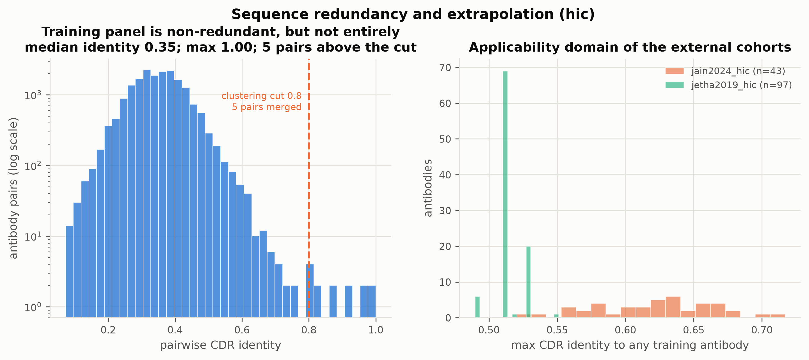
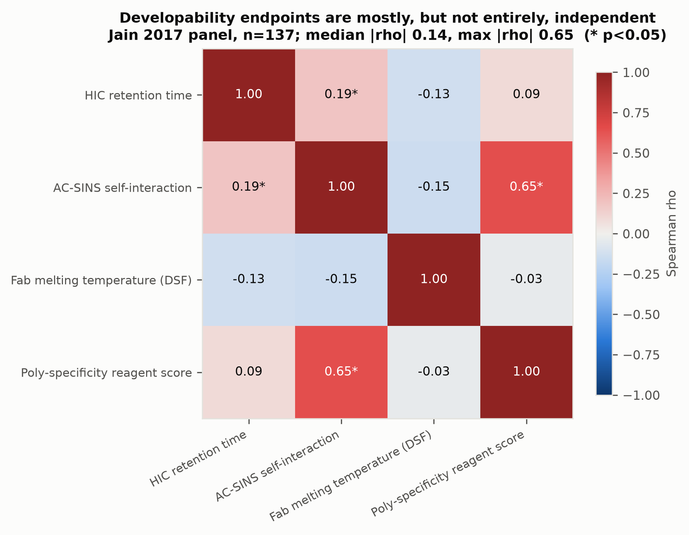
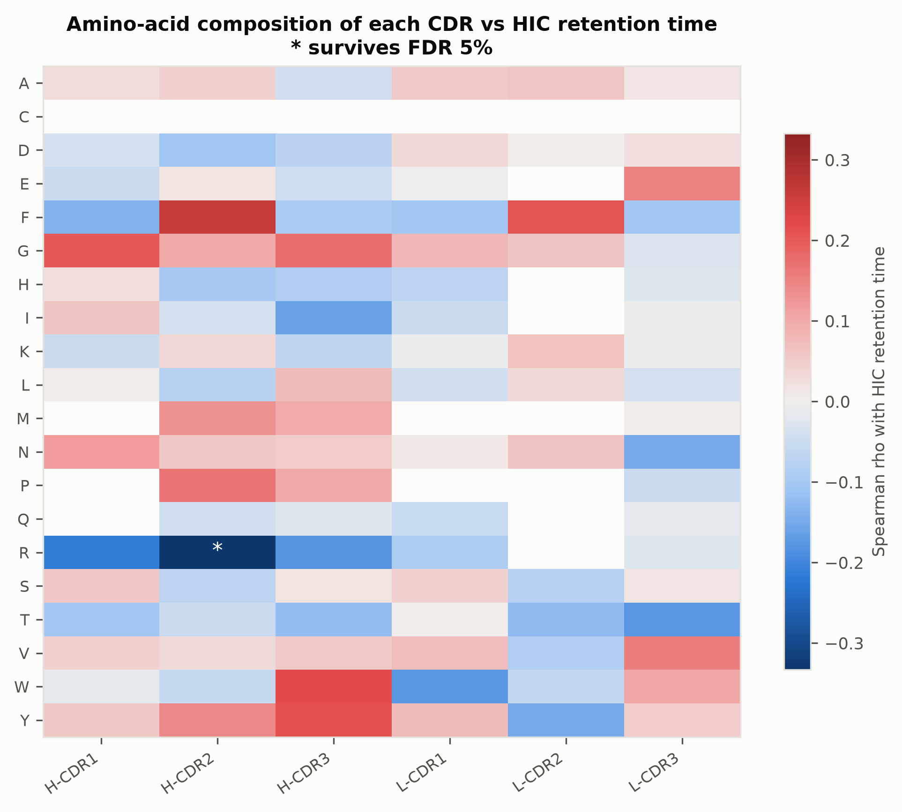
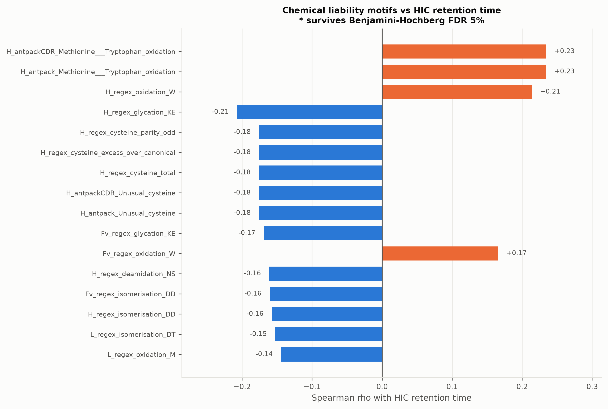
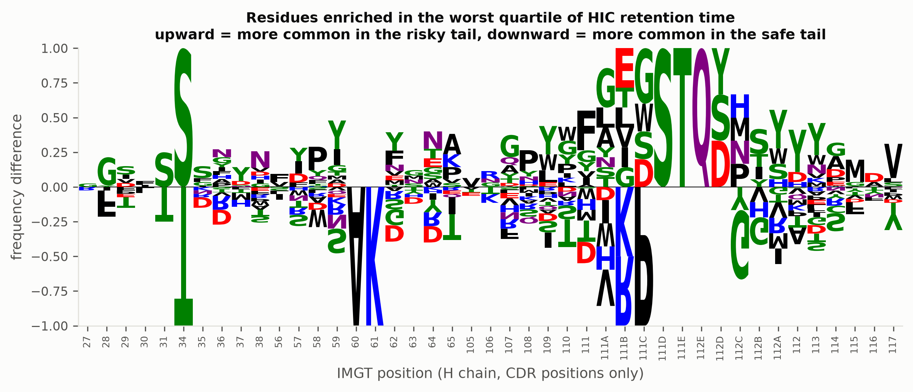
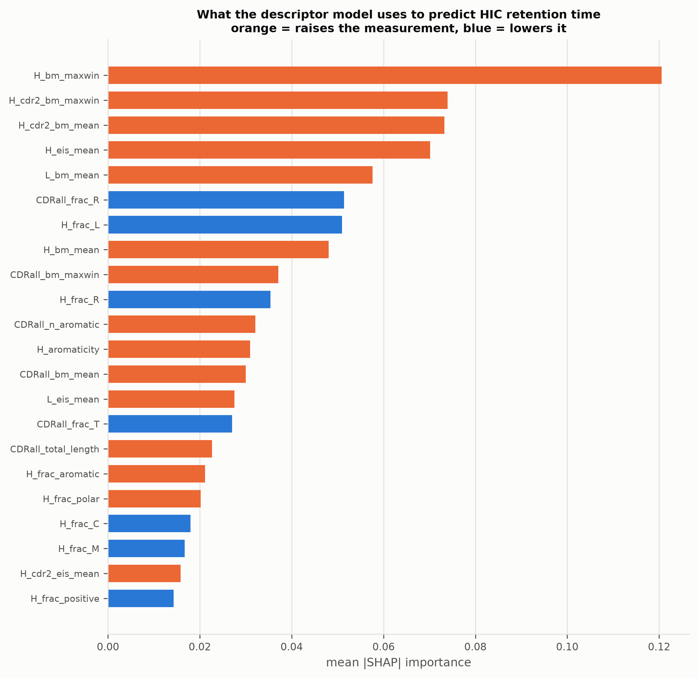
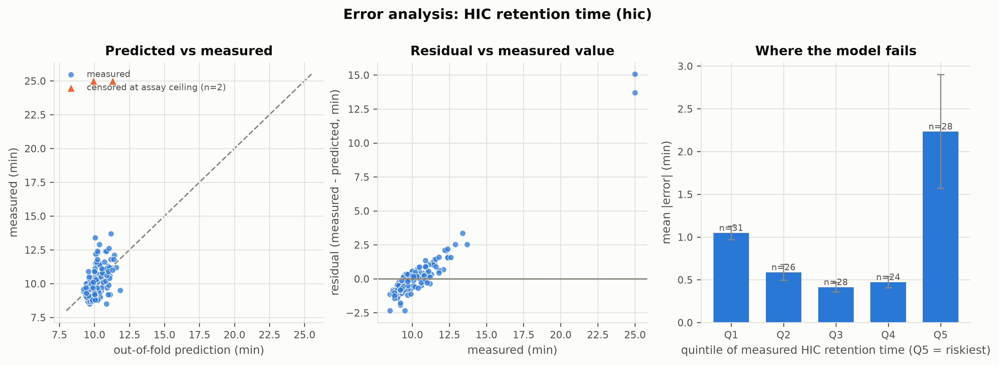
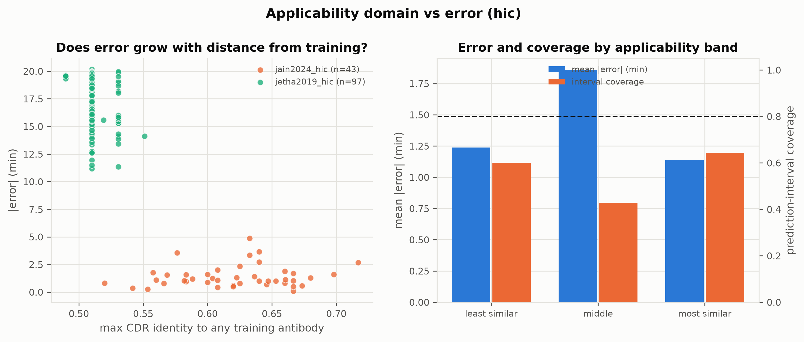

# Predicting Antibody Developability from Sequence

### A reproducible model for HIC retention time, with held-out validation and interpretable sequence determinants

**Generated:** 2026-10-11 19:44 UTC
**Primary endpoint:** HIC retention time (min), Clinical-stage therapeutic antibodies
**Dataset:** FLAb (Gray Lab), pinned at commit `e05e3f0135`

---

## Abstract

Antibody candidates fail in development for reasons unrelated to target
binding: aggregation, self-association, poor expression and viscosity. We
build a reproducible, sequence-only model for one precisely defined
developability endpoint -- hydrophobic interaction chromatography (HIC)
retention time -- rather than pooling incompatible assays, and we test it on
antibodies the model never saw.

Training uses the 137 clinical-stage antibodies of
Jain et al. (2017). The best configuration was **desc_all**
features with a **svr_rbf** model, reaching Spearman rho = 0.443 (95% CI 0.302 to 0.566), MAE = 0.97 min under
repeated CDR-clustered cross-validation. On the fully held-out jain2024_hic cohort (n=43), rho = 0.492 and MAE = 1.41 min.

We compare interpretable physicochemical descriptors against two protein
language models with the same hidden width -- the antibody-specific **AbLang2**
(480-d, one pass over the paired chains) and the general-protein **ESM-2 35M**
(480-d per chain, heavy and light embedded separately and concatenated to
960-d). The two models therefore have the same representational width per
forward pass, though ESM-2's final feature vector is twice as long because it
cannot encode the chain pairing in a single pass. We additionally
identify the sequence features that drive the endpoint, recovering the known
biophysics from data: CDR hydrophobicity and aromatic content raise retention,
while positive charge lowers it.

---

## 1. Data and endpoint definition

### 1.1 Why one endpoint, and why this one

The project brief warns against mixing measurements taken under incompatible
conditions, and that warning is the single most important design constraint
here. FLAb aggregates assays that measure different physics in different units:
AC-SINS reports a plasmon wavelength shift in nm, PSR a unitless 0-1 score, Tm
a temperature, HIC a retention time. They are not interchangeable, and the
measured correlations between them on the very same 137 antibodies are mostly
weak -- with one instructive exception reported in Section 3.1 -- so a model
trained on their union would be fitting an artefact of which assay a row came
from.

We therefore chose **HIC retention time** as the single primary endpoint. It
is a single unambiguous assay readout; it is mechanistically tied to a real
liability (surface hydrophobicity driving aggregation and poor chromatographic
behaviour); and uniquely among FLAb's developability endpoints it appears in
three independent cohorts, which supplies genuinely unseen antibodies rather
than a reshuffle of the training set.

Three secondary endpoints -- AC-SINS, Fab Tm and PSR -- are modelled with the
identical pipeline but **never pooled** with HIC or with each other. They serve
to test whether the method generalises across endpoints, not to enlarge the
training set.

### 1.2 Provenance

All data comes from the FLAb repository at a pinned commit, with SHA-256
hashes recorded in `data/processed/data_manifest.json`.

| file | cohort | rows | assay column | source |
|---|---|---|---|---|
| `jain2017biophyscial_HICRT.csv` | Clinical-stage therapeutic antibodies | 137 | `HIC Retention Time (Min)a` | Jain et al. 2017 |
| `jain2024assessment_HIC.csv` | Germline Fv antibodies | 43 | `HIC RT (min)` | Jain et al. 2024 |
| `jetha2019homology_RT.csv` | Integrin alpha-11 Fv antibodies | 97 | `HIC RT (min)` | Jetha et al. 2019 |

A deliberate choice: the measurement is read from the **named raw assay
column**, never from FLAb's derived `fitness` column. We verified that
`fitness` is a verbatim copy of the raw value and therefore does **not** encode
the direction of merit -- the thermostability file (higher is better) and the
HIC file (lower is better) are stored identically. Any pipeline that assumes
"higher fitness is better" silently inverts three of our four endpoints.

### 1.3 Curation

Sequences are uppercased, stripped of gaps and validated against the twenty
standard amino acids; the measurement is coerced to numeric; exact duplicate
(heavy, light) pairs are collapsed to their median. For the primary endpoint
this removed nothing -- the source is already clean:

- rows in source: 137
- dropped for bad sequence: 0 heavy, 0 light
- dropped for non-numeric value: 0
- duplicate antibodies collapsed: 0

### 1.4 Cross-cohort leakage control

Before any modelling, every external antibody that also occurs in training is
removed, so "external" means what it says.

| cohort | n before | exact pair overlap | heavy-only | light-only | n after |
|---|---|---|---|---|---|
| jain2024_hic | 43 | 0 | 0 | 0 | 43 |
| jetha2019_hic | 97 | 0 | 0 | 0 | 97 |

**There is no exact overlap at all** between the three HIC cohorts -- no shared
antibody, no shared heavy chain, no shared light chain. The external sets are
genuinely unseen.

### 1.5 Cohort statistics

| cohort | n | min | median | max | mean | sd | censored | risk+ |
|---|---|---|---|---|---|---|---|---|
| jain2017_hic | 137 | 8.50 | 9.90 | 25.00 | 10.33 | 2.10 | 2 | 15 |
| jain2024_hic | 43 | 8.40 | 9.90 | 16.00 | 10.69 | 2.06 | 0 | 11 |
| jetha2019_hic | 97 | 21.27 | 27.59 | 30.00 | 27.20 | 2.57 | 30 | 97 |


Two findings here shaped the rest of the study.

**The Jain 2024 cohort is directly comparable.** Its HIC was run on the same
platform, column and gradient as the 2017 panel, and the empirical
distributions agree closely (both median 9.9 min). Absolute-error metrics in
minutes are therefore meaningful on this cohort, not just rank metrics.

**The jetha2019_hic cohort is not a validation set and we do not treat it as one.** It fails three separate tests. It is a point-mutant library of a *single* parent Fv rather than a diverse panel: the data audit (see `docs/METHODOLOGY.md`) found every heavy chain the same length with pairwise Hamming distance at most 3, and all but seven rows sharing one identical light chain. It is right-censored, with **30 of 97** values (31%) pinned at exactly the column run-time ceiling. And it sits on a different absolute scale entirely (median 27.6 min against 9.9 for the training cohort). Applying the published risk threshold to it flags **97 of 97** antibodies, which is the clearest possible demonstration that the scales are not transferable. We report it as an out-of-distribution ranking stress test with those caveats stated, and we draw no validation claim from it.

The training endpoint is itself mildly censored: **2 of 137** antibodies sit at the maximum measurement time. They are retained -- removing the hardest examples would flatter the model -- but flagged, so the headline result can be recomputed without them.

### 1.6 Risk labels

The binary risk label uses the **published** Jain et al. 2017 warning threshold of **above 11.7 min**, defined there as the worst decile of the 48 *approved* antibodies -- not of all 137. Using a published, clinically anchored cut rather than a quantile of our own sample matters for a specific reason: a quantile forces the same positive rate in every cohort by construction, which would make any cross-cohort classification comparison vacuous. A fixed threshold has a stable meaning and transfers unchanged. On the training panel it flags **15 of 137** antibodies (10.9%), reproducing the intended ~10% rate and confirming our curation matches the published cohort. The distributional cuts are retained as `risk_label_q80` / `risk_label_q90` columns for sensitivity analysis.

---

## 2. Methods

### 2.1 Features

Six feature sets are compared, plus a deliberately trivial floor.

| feature set | dimensions | description |
|---|---|---|
| `baseline_trivial` | 4 | chain lengths + mean hydropathy -- the floor any real model must beat |
| `desc_global` | 128 | whole-chain composition, hydropathy, charge, pI, stability, liability counts |
| `desc_cdr` | 260 | the same descriptors restricted to the six IMGT CDRs, plus TAP-style aggregates |
| `desc_all` | 388 | desc_global + desc_cdr |
| `esm2_35m` | 960 | ESM-2 35M mean-pooled over residues, heavy and light concatenated |
| `ablang2` | 480 | AbLang2-paired sequence embedding (antibody-specific, sees both chains jointly) |
| `desc_all+ablang2` | 868 | late fusion of interpretable descriptors and the antibody language model |

Antibody numbering, CDR extraction, germline V/J assignment and chemical
liability annotation all use **AntPack** with the IMGT scheme. ANARCI, the
field standard, shells out to HMMER and has no supported Windows build;
AntPack is a pure pip install with one dependency and was verified against
published trastuzumab CDRs before use. All 277 antibodies numbered
successfully. One antibody produced a framework warning (a natural `WDQGT`
instead of the canonical `WGQGT` in FR4) which we deliberately treat as a
warning rather than a failure -- its numbering is correct, and discarding real
antibodies for having unusual frameworks is exactly the wrong behaviour in a
developability study.

The two language models share a hidden width of 480, which keeps the
comparison close to like-for-like, but they do **not** yield vectors of equal
length. AbLang2-paired makes one pass over the joined chains and emits 480
dimensions. ESM-2 35M has no paired-chain separator token, so gluing the chains
together with an artificial linker would put it out of distribution; each chain
is embedded in its own pass and the two 480-d vectors are concatenated to 960.

This asymmetry is a property of the models, not a design choice we could have
avoided, and it matters for how the comparison is read: any advantage from
sheer representation capacity favours ESM-2, which has twice as many features
for the same 137 training antibodies. If AbLang2 wins, it wins from the
smaller representation; if ESM-2 wins, part of the margin may be capacity
rather than pre-training. The report states this wherever the two are compared
instead of claiming a width-matched contrast.

### 2.2 Leakage-safe splitting

Every antibody variable domain shares 70-85% framework identity with every
other, so whole-sequence identity is useless for deciding whether two
antibodies are near-duplicates. We cluster on **CDR identity only**, aligning
the six IMGT CDRs region by region and using single-linkage agglomerative
clustering, then split by cluster with target-stratified grouped K-fold.

Measured redundancy of the training panel:

- mean pairwise CDR identity: **0.352**
- maximum pairwise CDR identity: 1.000
- pairs above 0.8 identity: **5** out of 9316

| identity cut | clusters | largest cluster | singletons |
|---|---|---|---|
| 0.7 | 128 | 3 | 121 |
| 0.8 | 132 | 2 | 127 |
| 0.9 | 134 | 2 | 131 |

This is a largely non-redundant panel. At the 0.8 cut, 137 antibodies form
132 clusters whose largest
member count is 2.
Clustered and random splitting should therefore give a similar answer here --
and Section 3.4 reports what the difference actually was.

"Largely" is doing real work in that sentence, though. The maximum pairwise
CDR identity in the panel is 1.00,
and these are the pairs the protocol exists to separate:

| CDR identity | antibody A | antibody B | value A | value B | difference | V gene A | V gene B | merged |
|---|---|---|---|---|---|---|---|---|
| 1.000 | jain2017_hic_0077 | jain2017_hic_0131 | 8.90 | 8.80 | 0.10 | IGHV1-46 | IGHV3-30 | yes |
| 0.957 | jain2017_hic_0076 | jain2017_hic_0079 | 10.80 | 11.10 | 0.30 | IGHV1-3 | IGHV1-46 | yes |
| 0.920 | jain2017_hic_0029 | jain2017_hic_0035 | 12.10 | 11.80 | 0.30 | IGHV3-23 | IGHV3-23 | yes |
| 0.870 | jain2017_hic_0133 | jain2017_hic_0134 | 9.70 | 9.30 | 0.40 | IGHV2-70 | IGHV2-70 | yes |
| 0.822 | jain2017_hic_0023 | jain2017_hic_0045 | 11.30 | 11.00 | 0.30 | IGHV3-7 | IGHV3-21 | yes |

The top pair has **identical CDRs across all six loops** on two different
germline frameworks, and their measured values differ by only
0.10
min. Put one in training and the other in test and the model can
"predict" it by recall. That single pair is the entire justification for
clustering on CDR identity rather than splitting at random, and it is why we
keep the protocol even though its aggregate effect on this panel is small. On
the Jetha cohort, where every antibody is a point mutant of one parent, the
same check would merge almost everything.

**Applicability domain** -- maximum CDR identity of each external antibody to
anything in training:

| cohort | min | median | max |
|---|---|---|---|
| jain2024_hic | 0.520 | 0.625 | 0.717 |
| jetha2019_hic | 0.490 | 0.510 | 0.551 |



### 2.3 Evaluation protocol

- **Nested cross-validation.** Outer loop: 5-fold, CDR-cluster-grouped,
  target-stratified, repeated 5 times. Inner loop: grouped grid search
  within each outer training fold. Hyper-parameters never see the outer test fold.
- **Pooled, not averaged.** With ~27 antibodies per test fold, R-squared and Spearman
  computed per fold are extremely noisy and averaging them is biased. We pool
  out-of-fold predictions across each repeat and compute one metric on all 137.
- **Intervals, not point estimates.** Every headline metric carries a percentile
  bootstrap 95% CI (2000 resamples).
- **Two significance tests.** A label-permutation test on the final correlation,
  and -- for the headline configuration only -- a full-refit permutation test
  that re-runs the entire nested CV on permuted labels, so the p-value accounts
  for the hyper-parameter search as well.
- **Paired comparison.** Models are compared by paired bootstrap on the same
  antibodies, which cancels the shared "which antibodies did we draw" variance
  that makes two overlapping marginal CIs misleading.
- **Conformal intervals.** Split-conformal calibration on out-of-fold residuals
  gives 80% prediction intervals; measured coverage is reported
  rather than assumed, because cohort shift breaks the exchangeability the
  guarantee rests on.

Hyper-parameters are selected on negative MAE rather than RMSE: the HIC
distribution has a long right tail, and RMSE would let a handful of extreme
antibodies decide the model. All four regression metrics are reported
regardless.

---

## 3. Results

### 3.1 The endpoints are not interchangeable



The strongest relationship between any two endpoints on the same 137 antibodies is acsins vs psr at rho = 0.65. Some pairs ARE substantially related -- acsins vs psr (rho = 0.65) -- which is unsurprising where two assays probe overlapping physics. But the median absolute correlation across all 6 pairs is only 0.14, so the endpoints are still far from interchangeable. This is the empirical justification for refusing to pool assays:
knowing how an antibody behaves in one developability assay constrains its
behaviour in another only loosely. "Developability" is not one quantity.

### 3.2 Feature set and model comparison

Best model per feature set, by cross-validated Spearman rho:

| feature set | best model | dims | rho | rho sd | R2 | MAE | RMSE |
|---|---|---|---|---|---|---|---|
| desc_all | svr_rbf | 388 | 0.536 | 0.054 | 0.107 | 0.93 | 1.97 |
| desc_cdr | pls | 260 | 0.501 | 0.014 | 0.040 | 1.07 | 2.05 |
| desc_global | svr_rbf | 128 | 0.477 | 0.058 | 0.089 | 0.94 | 1.99 |
| desc_all+ablang2 | ridge | 868 | 0.468 | 0.033 | 0.074 | 1.00 | 2.01 |
| esm2_35m | svr_rbf | 960 | 0.387 | 0.051 | 0.033 | 0.98 | 2.05 |
| ablang2 | svr_rbf | 480 | 0.323 | 0.053 | -0.016 | 1.01 | 2.11 |
| baseline_trivial | pls | 4 | 0.257 | 0.019 | 0.002 | 1.09 | 2.09 |

Full sweep: `results/tables/cv_regression_hic.csv`.

The trivial floor -- four numbers, chain lengths and mean hydropathy -- reaches rho = 0.257. The best feature set (`desc_all`) reaches 0.536. That gap of 0.279 is the actual value added by everything more sophisticated, and quoting it keeps the headline number honest: a model is only interesting to the extent it beats the dumbest thing that could have worked.

**ESM-2 35M (0.387) matched or beat AbLang2 (0.323)** (difference 0.064). The two are not width-matched: AbLang2 contributes 480 dimensions in a single pass over the paired chains, while ESM-2 contributes 960 (480 per chain, concatenated, because it has no paired-chain separator token). Any capacity advantage therefore favours ESM-2. A paired bootstrap on the same antibodies, however, gives a difference of 0.105 with a 95% CI of -0.060 to 0.264 (FDR-adjusted p = 0.364). **The interval straddles zero, so at n=137 the two are not statistically distinguishable** and the ordering should not be over-interpreted. Antibody-specific pre-training did not help here, which is consistent with published observations that general protein language models can equal antibody-specific ones on hydrophobicity endpoints -- plausibly because HIC retention is driven by generic surface physics rather than by anything specifically immunological. Notably, the interpretable descriptor set (0.536) was at least as good as either language model. With 137 training examples this is unsurprising: a 480- or 960-dimensional embedding has far more directions than the data can constrain, whereas the descriptors encode the relevant physics directly. The practical consequence is that we lose nothing by using the interpretable model, and gain the ability to say *why* a prediction came out the way it did.

### 3.3 Headline model

**desc_all + svr_rbf**, over
5 repeats of 5-fold
clustered CV.

Two different uncertainties are reported, and they are not interchangeable.
The **across-repeat mean +/- SD** is the headline: it averages the metric over
independent fold assignments, so it is the stable estimate and its SD says how
much the number moves when the folds are redrawn. The **bootstrap CI** is
computed on one repeat's out-of-fold vector and says how much the number would
move if we had drawn a different sample of 137 antibodies.

| metric | across-repeat mean | SD across repeats | single-repeat value | 95% bootstrap CI |
|---|---|---|---|---|
| Spearman rho | 0.536 | 0.054 | 0.443 | 0.302 to 0.566 |
| Pearson r | 0.374 | 0.051 | 0.314 | 0.130 to 0.521 |
| R-squared | 0.107 | 0.011 | 0.090 | -0.008 to 0.249 |
| MAE (min) | 0.93 | 0.02 | 0.97 | 0.73 to 1.31 |
| RMSE (min) | 1.97 | 0.01 | 1.99 | 0.92 to 2.96 |

**Read the rank metric and the variance metric as answering different questions.** Spearman is 0.443 while R-squared is only 0.090. That combination is characteristic of a long-tailed endpoint: the model orders antibodies well, but the variance it must explain is dominated by a handful of extreme values in the tail that it systematically under-predicts, and R-squared is squared-error-based so those few antibodies dominate it. For scale: always predicting the training median would give a mean absolute error of 1.07, against the model's 0.97 -- a 9% reduction.

For the actual use case -- ranking candidates to decide which to express and assay first -- the rank metric is the relevant one, and we report R-squared alongside it rather than quietly omitting the less flattering number.

These come from **one repeat's complete out-of-fold vector**, not from an
average across repeats. Each repeat already predicts every antibody exactly
once from a model that never saw it; averaging the five repeats would bag five
models and report an ensemble's performance under a single model's name, which
would overstate what the deployed model does on new antibodies. The
across-repeat mean and spread of the same metric are in the sweep table above
as `rho` and `rho sd`.

**Two caveats on these intervals.**

1. The bootstrap resamples antibodies into a *fixed* prediction vector, so it
   captures sampling variance over which antibodies we happen to hold -- not
   the variance from re-drawing folds or refitting the model. The
   across-repeat standard deviation in the sweep table is the complementary
   quantity, and the honest reading uses both.
2. This configuration was selected as the best of 49
   configurations scored on these same 137 antibodies. Its cross-validated
   metric is therefore optimistically biased by selection, and no interval
   computed on the same data removes that bias. The external cohort in Section
   3.5 -- never touched during selection -- is the guard against it.

**Significance.** The correlation-only permutation test gives
p = 0.0010 against a null centred at
rho = 0.002 (sd 0.085).
The stronger full-refit permutation test -- which re-runs the entire nested cross-validation, hyper-parameter search included, on 100 label permutations -- gives p = 0.0099. The permuted null is centred at rho = -0.093 with a 95th percentile of 0.067, against an observed statistic of 0.443. Note that the observed value here is the **single-repeat** Spearman, not the across-repeat mean, because the null is built from single-repeat runs and the two have to be constructed the same way to be comparable. This is the honest test of the whole pipeline rather than of the final correlation alone: it prices in the hyper-parameter search as well.

### 3.4 Does the splitting protocol matter?

| protocol | Spearman rho (mean +/- SD over repeats) | MAE |
|---|---|---|
| CDR-clustered, grouped inner CV (reported) | 0.536 +/- 0.054 | 0.93 |
| Fully random, ungrouped inner CV | 0.556 +/- 0.025 | 0.91 |
| **Difference** | **0.020** (SE 0.026) | |

Both arms are averaged over 5 repeats,
because a single repeat's Spearman moves by several hundredths from fold
assignment alone and differencing two single repeats would charge that noise to
the protocol.

The gap is 0.020 with a standard error of 0.026, so it is **within two standard errors of zero** and this experiment cannot distinguish the two protocols. That is the expected result on a panel with only a handful of near-duplicate pairs: there is very little leakage available for a random split to exploit. We report the clustered numbers regardless, because a protocol should be correct by construction rather than because a check happened to come out flat -- and on the Jetha cohort, where every antibody is a point mutant of one parent, the same comparison would not come out flat at all.

### 3.5 External validation

| cohort | role | n | rho | CI low | CI high | MAE | RMSE | R2 | PI coverage |
|---|---|---|---|---|---|---|---|---|---|
| jain2024_hic | external_validation | 43 | 0.492 | 0.200 | 0.728 | 1.41 | 1.72 | 0.283 | 0.56 |
| jetha2019_hic | stress_test | 97 | 0.409 | 0.231 | 0.561 | 16.92 | 17.09 | -43.872 | 0.00 |

On **jain2024_hic** (n=43), a cohort of antibodies the model has never seen, measured on the same assay platform, Spearman is 0.492 and its CI excludes zero. MAE is 1.41 min. Because this cohort shares the 2017 absolute scale, the error in minutes is directly interpretable rather than merely ordinal.

The 80% conformal prediction intervals achieved 56% empirical coverage on this cohort -- away from nominal, which is exactly what we warned could happen: conformal coverage is guaranteed only under exchangeability, and a different antibody population breaks that assumption.

On the **jetha2019_hic** stress test (n=97), Spearman is 0.409. Restricted to the 67 uncensored antibodies it is 0.383. We attach no validation weight to this number. The cohort is a point-mutant series of one parent antibody on a different chromatographic scale, a third of its labels are censored at the instrument ceiling, and its absolute errors are meaningless here (the model predicts ~10 min for antibodies measured at ~28 min). It is included to show what happens when a model is pushed well outside its applicability domain, and the honest answer is that it should not be used there.

### 3.6 Risk classification

Best model per feature set for the binary high-risk label (threshold
11.7 min, prevalence 10.9%):

| feature set | best model | ROC-AUC | PR-AUC | PR-AUC lift | MCC | F1 |
|---|---|---|---|---|---|---|
| ablang2 | lightgbm | 0.751 | 0.348 | 3.175 | 0.296 | 0.373 |
| desc_cdr | svc_rbf | 0.745 | 0.343 | 3.132 | 0.251 | 0.333 |
| desc_global | random_forest | 0.726 | 0.228 | 2.078 | 0.098 | 0.198 |
| desc_all | svc_rbf | 0.723 | 0.291 | 2.662 | 0.177 | 0.267 |
| desc_all+ablang2 | logistic | 0.711 | 0.302 | 2.761 | 0.221 | 0.307 |
| baseline_trivial | logistic | 0.622 | 0.246 | 2.245 | 0.087 | 0.187 |
| esm2_35m | logistic | 0.607 | 0.221 | 2.016 | 0.102 | 0.200 |

With only 15 positives, PR-AUC must be read against the prevalence baseline --
the "lift" column is PR-AUC divided by prevalence, and a value near 1.0 means
no better than chance regardless of how respectable the raw PR-AUC looks. MCC
is reported because it is the imbalance-robust single number; accuracy is
deliberately omitted as it is uninformative at this prevalence.

**The two tasks disagree about which representation is best.**

- `desc_all` ranks **1/7** for regression (rho = 0.536) but **4/7** for classification (ROC-AUC = 0.723).
- `ablang2` ranks **6/7** for regression (rho = 0.323) but **1/7** for classification (ROC-AUC = 0.751).

This is not a contradiction. Spearman over all 137 antibodies rewards getting the whole ordering right, most of which lies in a narrow bulk where the measurement barely varies; ROC-AUC rewards separating the 15 antibodies in the unfavourable tail from the rest. A representation can be weak at the former and strong at the latter -- which is the more useful behaviour for triage, where only the tail matters. The practical reading is that the regression and classification models should be selected independently rather than assuming one winner, and the report does exactly that.

---

## 4. What drives the endpoint

### 4.1 Univariate descriptor associations

49 of 353 descriptors are associated with HIC retention at a
Benjamini-Hochberg FDR of 5%.


| descriptor | Spearman rho | p | p (BH) |
|---|---|---|---|
| CDRall_n_hydrophobic | 0.422 | 2.8e-07 | 0.00006 |
| CDRall_bm_mean | 0.418 | 3.7e-07 | 0.00006 |
| CDRall_frac_R | -0.390 | 2.5e-06 | 0.00030 |
| CDRall_frac_positive | -0.371 | 7.9e-06 | 0.00070 |
| CDRall_eis_mean | 0.366 | 0.00001 | 0.00075 |
| CDRall_n_aromatic | 0.355 | 0.00002 | 0.00124 |
| CDRall_bm_maxwin | 0.344 | 0.00004 | 0.00157 |
| H_cdr2_bm_mean | 0.342 | 0.00004 | 0.00157 |
| H_cdr2_bm_maxwin | 0.341 | 0.00004 | 0.00157 |
| H_cdr3_bm_mean | 0.340 | 0.00005 | 0.00157 |
| H_frac_R | -0.340 | 0.00005 | 0.00157 |
| CDRall_frac_hydrophobic | 0.335 | 0.00006 | 0.00182 |
| H_frac_positive | -0.324 | 0.00011 | 0.00304 |
| H_frac_aromatic | 0.316 | 0.00017 | 0.00399 |
| H_aromaticity | 0.316 | 0.00017 | 0.00399 |

The pattern recovers the known biophysics of the assay without being told it:

- **Hydrophobicity raises retention.** Strongest: `CDRall_n_hydrophobic` (+0.42), `CDRall_bm_mean` (+0.42), `CDRall_eis_mean` (+0.37).
- **Aromatic content raises retention.** Strongest: `CDRall_n_aromatic` (+0.35), `H_frac_aromatic` (+0.32), `H_aromaticity` (+0.32).
- **Positive charge lowers retention.** Strongest: `CDRall_frac_R` (-0.39), `CDRall_frac_positive` (-0.37), `H_frac_R` (-0.34).

One methodological aside, measured rather than assumed: ranking the three hydrophobicity scales by their strongest association gives **Black-Mould** (max |rho| 0.42) > **Eisenberg** (max |rho| 0.37) > **Kyte-Doolittle** (max |rho| 0.21). Including three scales instead of defaulting to Kyte-Doolittle -- the most widely used, and the one the literature reports as a poor choice for HIC specifically -- turned a hidden assumption into a result that can be checked.

### 4.2 Amino-acid composition by CDR



1 of 102 (amino acid x CDR) combinations survive FDR
correction.

| chain | CDR | residue | rho | p (BH) | FDR 5% |
|---|---|---|---|---|---|
| H | cdr2 | R | -0.333 | 0.00711 | yes |
| H | cdr2 | F | 0.261 | 0.10389 | no |
| H | cdr3 | W | 0.219 | 0.25355 | no |
| H | cdr1 | R | -0.215 | 0.25355 | no |
| H | cdr3 | Y | 0.213 | 0.25355 | no |
| L | cdr2 | F | 0.206 | 0.26207 | no |
| H | cdr1 | G | 0.202 | 0.26207 | no |
| H | cdr3 | R | -0.177 | 0.38043 | no |
| H | cdr3 | G | 0.176 | 0.38043 | no |
| L | cdr3 | T | -0.175 | 0.38043 | no |
| L | cdr1 | W | -0.175 | 0.38043 | no |
| H | cdr2 | P | 0.169 | 0.41621 | no |

### 4.3 Chemical liability motifs



| motif feature | mean (risk+) | mean (risk-) | rho | p (BH) | FDR 5% |
|---|---|---|---|---|---|
| H_antpackCDR_Methionine___Tryptophan_oxidation | 1.40 | 1.07 | 0.234 | 0.2310 | no |
| H_antpack_Methionine___Tryptophan_oxidation | 1.40 | 1.07 | 0.234 | 0.2310 | no |
| H_regex_oxidation_W | 4.47 | 3.97 | 0.214 | 0.3022 | no |
| H_regex_glycation_KE | 0.13 | 0.23 | -0.207 | 0.3022 | no |
| H_regex_cysteine_parity_odd | 0.00 | 0.02 | -0.176 | 0.3527 | no |
| H_regex_cysteine_excess_over_canonical | 0.00 | 0.02 | -0.176 | 0.3527 | no |
| H_regex_cysteine_total | 2.00 | 2.02 | -0.176 | 0.3527 | no |
| H_antpackCDR_Unusual_cysteine | 0.00 | 0.02 | -0.176 | 0.3527 | no |
| H_antpack_Unusual_cysteine | 0.00 | 0.02 | -0.176 | 0.3527 | no |
| Fv_regex_glycation_KE | 0.20 | 0.25 | -0.169 | 0.3741 | no |

**No chemical liability motif survives FDR correction.** This is a genuinely useful negative result. The canonical developability liabilities -- N-glycosylation sequons, NG/NS deamidation, DG/DS isomerisation, free cysteine -- are chemical-stability risks, and there is no particular reason they should predict a *chromatographic* hydrophobicity readout. They are reported by the screening tool alongside the prediction precisely because they are complementary information, not redundant with it: an antibody can have excellent predicted HIC behaviour and still carry a glycosylation sequon in CDR-H2 that will cause trouble later.

### 4.4 Position-specific enrichment

With every heavy chain aligned to a common IMGT numbering, we tested each
(position, residue) combination observed in at least 8 antibodies.
0 of 262 tests survive FDR correction.

| IMGT pos | region | residue | n | mean with | mean without | delta | p (BH) | FDR 5% |
|---|---|---|---|---|---|---|---|---|
| 28 | cdr1 | G | 16 | 11.99 | 10.11 | 1.89 | 0.08163 | no |
| 17 | framework | S | 15 | 12.78 | 10.03 | 2.75 | 0.08163 | no |
| 54 | framework | S | 19 | 9.42 | 10.48 | -1.06 | 0.12800 | no |
| 112 | cdr3 | Y | 21 | 10.76 | 10.25 | 0.51 | 0.16735 | no |
| 90 | framework | Q | 66 | 9.87 | 10.75 | -0.88 | 0.16735 | no |
| 117 | cdr3 | V | 29 | 11.09 | 10.12 | 0.97 | 0.16735 | no |
| 91 | framework | L | 66 | 10.78 | 9.91 | 0.87 | 0.16735 | no |
| 112A | cdr3 | Y | 14 | 11.83 | 10.16 | 1.67 | 0.18630 | no |
| 82 | framework | E | 11 | 13.35 | 10.06 | 3.29 | 0.18630 | no |
| 59 | cdr2 | Y | 16 | 10.89 | 10.25 | 0.64 | 0.22434 | no |
| 9 | framework | G | 60 | 9.89 | 10.67 | -0.79 | 0.22434 | no |
| 76 | framework | V | 51 | 10.96 | 9.95 | 1.01 | 0.22434 | no |

The table is ordered by raw p-value, so rows near the bottom may be nominally
significant without surviving correction; the `FDR 5%` column is the one that
matters.



Position-level results on 137 antibodies should be read as hypothesis
generation, not as established determinants. With several hundred tests and a
few dozen antibodies carrying any given residue at any given position, even
FDR-controlled hits need replication on an independent panel before anyone
should re-engineer a molecule on their basis.

### 4.5 What the model actually uses



| feature | importance | direction (signed rho) |
|---|---|---|
| H_bm_maxwin | 0.1206 | 0.775 |
| H_cdr2_bm_maxwin | 0.0739 | 0.806 |
| H_cdr2_bm_mean | 0.0732 | 0.827 |
| H_eis_mean | 0.0702 | 0.693 |
| L_bm_mean | 0.0576 | 0.776 |
| CDRall_frac_R | 0.0514 | -0.887 |
| H_frac_L | 0.0510 | -0.763 |
| H_bm_mean | 0.0481 | 0.601 |
| CDRall_bm_maxwin | 0.0371 | 0.874 |
| H_frac_R | 0.0354 | -0.691 |
| CDRall_n_aromatic | 0.0321 | 0.783 |
| H_aromaticity | 0.0310 | 0.776 |
| CDRall_bm_mean | 0.0300 | 0.899 |
| L_eis_mean | 0.0275 | 0.858 |
| CDRall_frac_T | 0.0270 | -0.840 |

Attribution is computed on the **descriptor** model rather than the overall
best model. Attributing 480 anonymous embedding dimensions would produce a
ranking nobody could act on; "CDR aromatic fraction" is a statement a protein
engineer can test at the bench.

---

## 5. Error analysis, applicability domain and ablation

### 5.1 Where the model fails



Overall out-of-fold MAE is 0.97 min.
The model is **5.15x less accurate on the high-risk antibodies** (MAE 3.44 min) than on the rest (MAE 0.67 min). That is the uncomfortable direction: triage cares about exactly the tail the model fits worst. Part of it is unavoidable -- the risky tail is sparse and long -- but it means the ranking should be trusted more for excluding safe candidates than for confidently condemning risky ones.

The fifteen worst-predicted antibodies:

| antibody | measured (min) | predicted | residual | high risk | censored | heavy V family |
|---|---|---|---|---|---|---|
| jain2017_hic_0078 | 25.00 | 9.93 | 15.07 | 1 | yes | IGHV1-69 |
| jain2017_hic_0121 | 25.00 | 11.31 | 13.69 | 1 | yes | IGHV1-69 |
| jain2017_hic_0021 | 13.40 | 10.04 | 3.36 | 1 | no | IGHV3-23 |
| jain2017_hic_0123 | 12.90 | 10.36 | 2.54 | 1 | no | IGHV1-69 |
| jain2017_hic_0072 | 13.70 | 11.17 | 2.53 | 1 | no | IGHV4-30-4 |
| jain2017_hic_0032 | 8.50 | 10.85 | -2.35 | 0 | no | IGHV3-74 |
| jain2017_hic_0044 | 9.50 | 11.84 | -2.34 | 0 | no | IGHV3-30 |
| jain2017_hic_0135 | 12.40 | 10.20 | 2.20 | 1 | no | IGHV2-70 |
| jain2017_hic_0065 | 12.20 | 10.09 | 2.11 | 1 | no | IGHV4-38-2 |
| jain2017_hic_0055 | 12.30 | 10.23 | 2.07 | 1 | no | IGHV1-3 |
| jain2017_hic_0030 | 9.20 | 11.12 | -1.92 | 0 | no | IGHV3-66 |
| jain2017_hic_0081 | 9.20 | 10.98 | -1.78 | 0 | no | IGHV1-46 |
| jain2017_hic_0062 | 12.40 | 10.78 | 1.62 | 1 | no | IGHV3-30-5 |
| jain2017_hic_0107 | 11.80 | 10.21 | 1.59 | 1 | no | IGHV1-2 |
| jain2017_hic_0067 | 12.60 | 11.03 | 1.57 | 1 | no | IGHV4-59 |

Censored antibodies appear here by construction: their recorded value is the
assay ceiling rather than a measurement, so a model that predicts the true
(higher) value is penalised for being right.

### 5.2 Is the error concentrated in one germline family?


| V family | n | mean measured (min) | mean, others | mean residual (min) | p (BH) | biased at FDR 5% |
|---|---|---|---|---|---|---|
| IGHV1-69 | 10 | 13.89 | 10.05 | 3.35 | 0.0550 | no |
| IGHV1-18 | 5 | 10.12 | 10.34 | 0.36 | 0.4739 | no |
| IGHV1-2 | 7 | 10.29 | 10.33 | 0.23 | 0.6096 | no |
| IGHV1-3 | 10 | 10.36 | 10.33 | 0.13 | 0.9224 | no |
| IGHV3-30-5 | 6 | 10.23 | 10.33 | 0.05 | 0.9224 | no |
| IGHV3-23 | 21 | 10.06 | 10.38 | -0.03 | 0.9224 | no |
| IGHV3-21 | 5 | 9.80 | 10.35 | -0.03 | 0.9224 | no |
| IGHV3-30 | 5 | 10.14 | 10.34 | -0.20 | 0.9224 | no |
| IGHV1-46 | 16 | 9.84 | 10.39 | -0.36 | 0.4739 | no |
| IGHV3-66 | 7 | 9.57 | 10.37 | -0.59 | 0.4739 | no |

No germline family's residual survives FDR correction across the 10 families tested. The largest effect is **IGHV1-69** (n=10), which the model under-predicts by 3.35 min. That is nominally significant (p = 0.0055) but **does not survive** correction across 10 families (FDR-adjusted p = 0.055), so we report it as a hypothesis, not a finding. Separately, IGHV1-69 **is** confirmed as the most extreme family on this assay: it measures a mean of 13.89 min against 10.05 for everything else, and that difference does survive correction (FDR-adjusted p = 0.0034).

That is mechanistically coherent. IGHV1-69 carries an unusually hydrophobic CDR-H2 apex -- the isoleucine and phenylalanine pair that makes it the germline of choice for influenza-stem and other hydrophobic-epitope antibodies -- so it is exactly the family a hydrophobicity assay should retain longest, and exactly the family a model trained mostly on well-behaved antibodies will pull back toward the mean. It accounts for much of the tail error in Section 5.1.

The practical caution is cheap to apply regardless: when screening IGHV1-69-derived candidates, treat the predicted value as a floor. Confirming this properly needs an independent panel with more than 10 members of the family.

### 5.3 Does the applicability-domain flag work?



Within this external cohort, error does **not** track distance from the training set (Spearman between max CDR identity and |error| = 0.100, p = 0.525). The honest reading is that the cohort spans too narrow an identity range (roughly 0.52-0.72) to resolve the relationship, not that extrapolation is safe. The flag remains a warning, but this analysis does not independently validate its calibration.

| applicability band | n | mean identity to train | MAE (min) | interval coverage |
|---|---|---|---|---|
| least similar | 15 | 0.572 | 1.24 | 0.60 |
| middle | 14 | 0.626 | 1.86 | 0.43 |
| most similar | 14 | 0.669 | 1.14 | 0.64 |

Coverage is reported per band rather than only in aggregate, because an
interval that covers 80% overall while covering 95% of the easy cases and 55%
of the hard ones is not calibrated where it matters.

### 5.4 Which descriptor families carry the signal?


Two complementary views: drop one family and measure the loss, then use each
family alone. The first says what is *redundant* (dropping a family that other
families already encode costs nothing); the second says what is *sufficient*.

| configuration | features | Spearman | change vs full set |
|---|---|---|---|
| none (full descriptor set) | 388 | 0.483 | 0.000 |
| drop composition | 247 | 0.525 | 0.043 |
| drop hydropathy | 334 | 0.460 | -0.022 |
| drop charge_and_pI | 356 | 0.470 | -0.013 |
| drop cdr_restricted | 128 | 0.431 | -0.051 |
| drop liability_motifs | 252 | 0.460 | -0.022 |
| drop size_and_stability | 367 | 0.458 | -0.025 |
| only composition | 141 | 0.357 | -0.126 |
| only hydropathy | 54 | 0.423 | -0.059 |
| only charge_and_pI | 32 | 0.136 | -0.346 |
| only cdr_restricted | 260 | 0.494 | 0.011 |
| only liability_motifs | 136 | 0.215 | -0.268 |
| only size_and_stability | 21 | 0.308 | -0.174 |

Removing **cdr_restricted** costs the most (-0.051 Spearman), so it carries signal the other families do not duplicate. Dropping composition costs essentially nothing, which means that information is already carried by the families that remain -- redundancy, not irrelevance. On its own, **cdr_restricted** reaches Spearman 0.494 from just 260 features -- most of what the full 388-feature set achieves.

---

## 6. The same pipeline on three other endpoints

Each endpoint is modelled **independently**, with its own training cohort, its
own external cohort and its own risk threshold. Nothing is pooled.

| endpoint | units | features | model | CV rho | CV rho sd | CV R2 | CV MAE | ext rho | ext MAE |
|---|---|---|---|---|---|---|---|---|---|
| HIC retention time | min | desc_all | svr_rbf | 0.536 | 0.054 | 0.107 | 0.935 | 0.492 | 1.408 |
| AC-SINS self-interaction | nm | ablang2 | elasticnet | 0.426 | 0.054 | 0.110 | 7.397 | 0.272 | 6.422 |
| Fab melting temperature (DSF) | degC | desc_all+ablang2 | elasticnet | 0.508 | 0.028 | 0.252 | 4.058 | 0.437 | 4.652 |
| Poly-specificity reagent score | a.u. (0-1) | desc_global | pls | 0.388 | 0.022 | 0.130 | 0.143 | 0.304 | 0.380 |

The spread across endpoints is itself informative. Endpoints differ in how
predictable they are from sequence alone, and reporting all four -- including
the ones the method handles poorly -- is more useful than selecting the one
that happened to work.

**No single representation wins everywhere.** Best feature set per endpoint: **HIC retention time** -> `desc_all` (0.536); **AC-SINS self-interaction** -> `ablang2` (0.426); **Fab melting temperature (DSF)** -> `desc_all+ablang2` (0.508); **Poly-specificity reagent score** -> `desc_global` (0.388).

Specifically: interpretable descriptors win on HIC retention time, Poly-specificity reagent score; a language-model representation wins on AC-SINS self-interaction; a descriptor/embedding hybrid wins on Fab melting temperature (DSF).

A plausible reading -- and it is only that, on four endpoints -- is that HIC retention is dominated by bulk hydrophobicity, which the descriptors encode directly and explicitly. Self-association and polyreactivity instead depend on how charge and surface patches are arranged across the whole Fv, which is harder to write down as a descriptor but is the kind of structure a language model can learn. Testing that properly would need more endpoints than we have, and the gaps between representations are small relative to their across-repeat spread.

This is a further argument against treating "developability" as one quantity with one model: the endpoints differ not only in how predictable they are, but in what kind of representation predicts them.

The PSR endpoint deserves a specific caveat: 72 of 137 training values are
exactly 0.00, the assay floor. A Spearman correlation against a target whose
median, first quartile and minimum are all identical is largely a
tie-breaking exercise, and the regression framing is a poor fit for it. A
zero-versus-nonzero classification would be the more defensible treatment of
that endpoint.

---

## 7. Honest positioning against the literature

Our result should be read against what has actually been achieved on this
panel. The comparator rows below are **values quoted from the published
literature**, transcribed from the sources cited in
`docs/LITERATURE_REVIEW.md`; this pipeline cannot verify them, and they are
the only numbers in this report not generated by it. Only the final row is
our own result.

| study | features | protocol | reported |
|---|---|---|---|
| Hebditch & Warwicker 2019 | 35 Fv sequence features | 50x repeated 10-fold CV | R2 = 0.391, MAE 0.702 |
| Karlberg et al. 2020 | sequence only | 80/20 Kennard-Stone external split (n=81) | R2 = 0.25 |
| Karlberg et al. 2020 | MD-relaxed structure | same split | R2 = 0.63 |
| PROPERMAB (Li et al. 2025) | 9 sequence + 26 **structure** features | nested LOO-CV (n=135) | r = 0.71, rho = 0.75 |
| FLAb zero-shot (2024) | PLM likelihoods, no supervision | zero-shot on Jain HIC | Pearson -0.08 to 0.24 |
| **This work** | sequence only | **5x5 CDR-clustered nested CV** | **rho = 0.443, R2 = 0.090** |

Three points of context matter for a fair reading:

1. **Zero-shot language models are not competitive on this task.** The FLAb
   benchmark found that AntiBERTy, IgLM, ProGen2, ProteinMPNN and ESM-IF
   likelihoods correlate with HIC at |r| <= 0.24, with most near zero.
   Supervision on even 137 examples is worth more than a large unsupervised
   model's prior.
2. **The best published numbers use structure.** PROPERMAB's rho = 0.75 rests
   on structural hydrophobic-patch descriptors from homology models. A
   sequence-only model is solving a harder problem, and comparing the two
   without saying so would be misleading.
3. **Protocol dominates the number.** Published work on much larger proprietary
   panels reports that moving from random splits to cluster-based splits costs
   0.2-0.3 Spearman. Any comparison that ignores the split protocol is not a
   comparison.

An upper bound is also worth stating: an independent re-measurement of 133 of
these antibodies on a different platform reproduced the original HIC values at
rho ~ 0.97. Assay noise is therefore *not* what limits prediction here -- the
remaining error is model and representation error, not measurement error.

---

## 8. Limitations

**Sample size.** 137 training antibodies is small for a 380-dimensional
descriptor space, let alone a 480- or 960-dimensional embedding. Confidence
intervals are correspondingly wide and should be quoted alongside every point
estimate. We mitigate this with nested CV, pooled out-of-fold metrics,
bootstrap intervals and permutation testing, but no analysis makes 137 points
behave like 10,000.

**Sequence-only features cannot see exposure.** HIC responds to *solvent-exposed*
apolar surface. A buried leucine contributes nothing, but a sequence-only
descriptor counts it identically to an exposed one. Our maximum-windowed
hydrophobicity is a one-dimensional shadow of a three-dimensional quantity, and
this is the single clearest reason structure-based models outperform on this
endpoint.

**One assay platform.** The model is calibrated to the Jain/Adimab HIC
platform. Retention time is not a physical constant: it depends on column
chemistry, salt system and gradient. The Jetha stress test demonstrates this
concretely -- predictions transfer in rank but not at all in absolute minutes.

**Conformal coverage is conditional.** The split-conformal guarantee assumes
calibration and test antibodies are exchangeable. A new cohort is by definition
not exchangeable with the training set, so measured coverage is reported for
each external cohort rather than claimed.

**Position-level findings are hypotheses.** Section 4.4 performs hundreds of
tests on 137 antibodies. FDR control limits the expected false-discovery rate
but does not make any single position a validated determinant.

**Selection across many configurations.** We compared 7 feature sets x up to 7
model families. The headline configuration was chosen by cross-validated
performance, which introduces selection optimism even under nested CV. The
external cohort is the real guard against this, which is why it was never
touched during model selection.

## 9. Responsible use

This model is a **triage and ranking aid, not a safety assessment**. Specific
constraints on legitimate use:

- A favourable prediction is not evidence that an antibody is developable. It
  is evidence that it resembles training antibodies that behaved well on one
  assay.
- Predictions for antibodies flagged `extrapolation` by the applicability-domain
  check should be treated as **unknown**, not as safe. The screening tool labels
  these explicitly rather than quoting a number with false confidence.
- Predictions in absolute minutes are only meaningful for antibodies measured
  on the same HIC platform. For any other platform, use the ranking only.
- The model is trained on clinical-stage therapeutic antibodies, which are a
  heavily filtered population -- they already survived earlier developability
  screening. Performance on naive repertoire antibodies is untested and should
  not be assumed.
- Chemical liability motif counts are rule-based annotations, not predictions,
  and are reported separately so that a clean predicted value does not mask a
  CDR glycosylation sequon.

**Data licensing.** FLAb is redistributed by the Gray Lab; the underlying
measurements belong to the cited primary publications. This project uses them
for non-commercial academic coursework. Anyone reusing this pipeline should
check the upstream repository and the primary papers for licence terms.

---

## 10. Reproducibility

```bash
# 1. Build the environment (once)
powershell -ExecutionPolicy Bypass -File .\scripts\00_setup_env.ps1

# 2. Run the whole study
powershell -ExecutionPolicy Bypass -File .\scripts\run_all.ps1

# 3. Screen new candidates with the trained model
.\.venv\Scripts\python.exe -m src.tool.screen \
    --input my_candidates.csv --endpoint hic \
    --output screened.csv --report screened.md
```

**Determinism.** A single global seed (`20261004`) drives split generation,
model initialisation, bootstrap resampling and permutation tests. Re-running
the pipeline on the same machine reproduces every number in this report.

**Data pinning.** FLAb is checked out at commit
`e05e3f0135783ffb7de412df6a1467e7a0031911`, and `data/processed/data_manifest.json`
records a SHA-256 hash of every consumed file, so a silent upstream change
cannot alter the results unnoticed.

**Environment pinning.** `requirements-lock.txt` pins all 76 resolved
packages. Key versions, read from that file at report-build time rather than
typed here: `ablang2` 0.2.1, `antpack` 0.3.8.6.2, `torch` 2.14.1+cpu, `transformers` 5.18.0, `fair-esm` 2.0.0, `scikit-learn` 1.9.1, `lightgbm` 4.7.0, `xgboost` 3.4.1, `biopython` 1.88, `shap` 0.52.0, `numpy` 2.5.3, `pandas` 3.0.6.

**Runtime.** About 60-90 minutes end to end on a 12-core laptop, CPU only, plus
roughly 10 minutes on the first run to download the AbLang2 (166 MB) and ESM-2
35M model weights. No GPU is required: with a few hundred antibodies it would
not help.

### Repository layout

```
src/
  config.py              endpoint definitions, split protocol, seeds
  data/
    acquire.py           pinned, sparse clone of FLAb + provenance manifest
    curate.py            cleaning, dedup, risk labels, leakage control
    splits.py            CDR-identity clustering, grouped folds, applicability domain
  features/
    numbering.py         AntPack IMGT numbering, CDRs, germlines, liabilities
    descriptors.py       physicochemical + CDR + TAP-style descriptors
    plm.py               AbLang2 and ESM-2 embeddings (cached)
    build.py             feature-set assembly
  models/
    zoo.py               estimators and hyper-parameter grids
    train.py             nested CV, external evaluation, permutation tests
    metrics.py           metrics, bootstrap CIs, conformal intervals
    experiment.py        the full sweep and its outputs
  analysis/
    eda.py               provenance and distribution figures
    motifs.py            liability, composition, positional and attribution analyses
    plotting.py          shared, colourblind-safe figure style
  tool/
    screen.py            the command-line screening tool
  report/
    build_report.py      generates this document from the result artefacts

results/      tables (CSV), figures (PNG), predictions, summary JSON
models_store/ serialised final models
docs/         literature review, methodology notes
```

### Outputs

| artefact | location |
|---|---|
| Curated datasets | `data/processed/dataset_*.csv` |
| Data manifest with hashes | `data/processed/data_manifest.json` |
| Split definitions | `data/processed/splits_*.json` |
| Cross-validation tables | `results/tables/cv_*.csv` |
| External validation | `results/tables/external_*.csv` |
| Out-of-fold predictions | `results/predictions/oof_*.csv` |
| Figures | `results/figures/*.png` |
| Trained models | `models_store/final_*.joblib` |
| Literature review | `docs/LITERATURE_REVIEW.md` |

---

## 11. References

See `docs/LITERATURE_REVIEW.md` for the full annotated reference list with
DOIs. Primary data sources:

- Jain T, et al. (2017). Biophysical properties of the clinical-stage antibody
  landscape. *PNAS* 114(5):944-949. doi:10.1073/pnas.1616408114
- Jain T, et al. (2024). Assessment and incorporation of in vitro correlates to
  pharmacokinetic outcomes in antibody developability workflows. *mAbs*
  16(1):2384104. doi:10.1080/19420862.2024.2384104
- Jetha A, et al. (2018). Homology modeling and structure-based design improve
  hydrophobic interaction chromatography behavior of integrin binding
  antibodies. *mAbs* 10(6):890-900. doi:10.1080/19420862.2018.1475871
- Chungyoun M, Ruffolo JA, Gray JJ (2024). FLAb: Benchmarking deep learning
  methods for antibody fitness prediction. *bioRxiv* 2024.01.13.575504
- Olsen TH, Moal IH, Deane CM (2024). AbLang2: addressing the antibody germline
  bias. *Bioinformatics*. (AbLang2 model)
- Lin Z, et al. (2023). Evolutionary-scale prediction of atomic-level protein
  structure with a language model. *Science* 379:1123-1130. (ESM-2)
